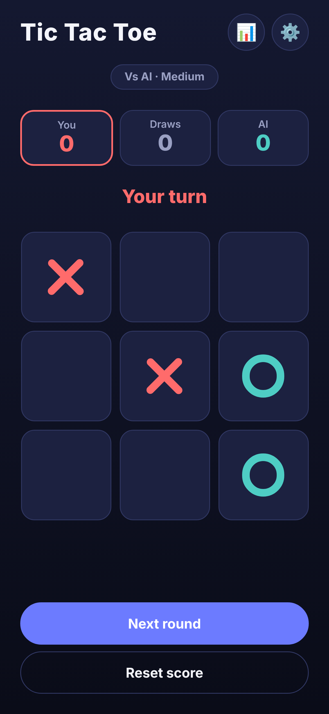
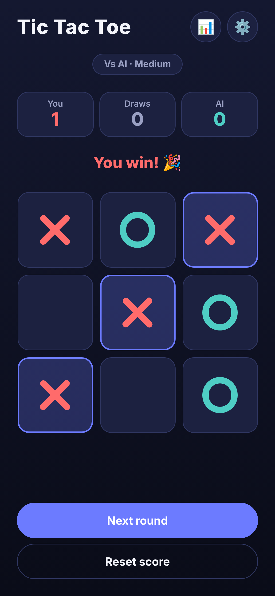
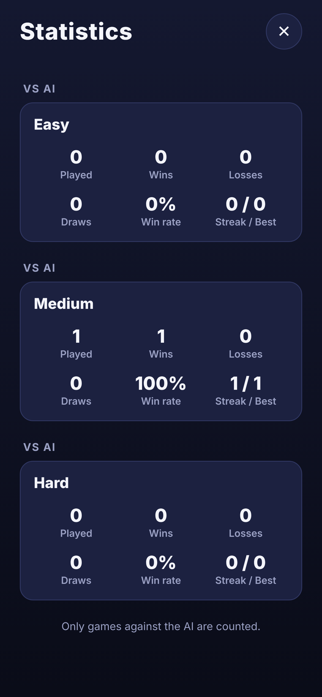
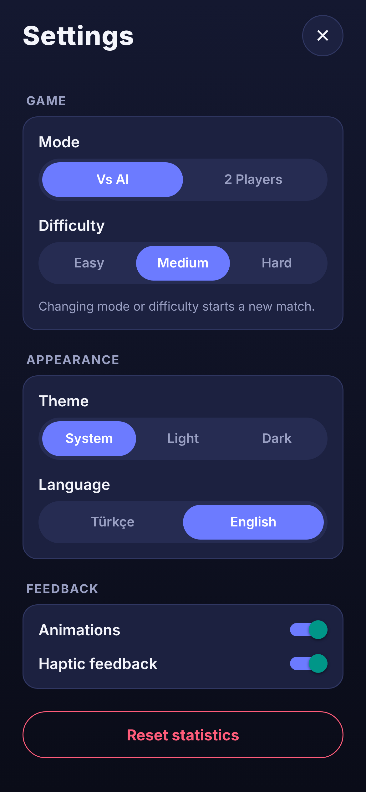
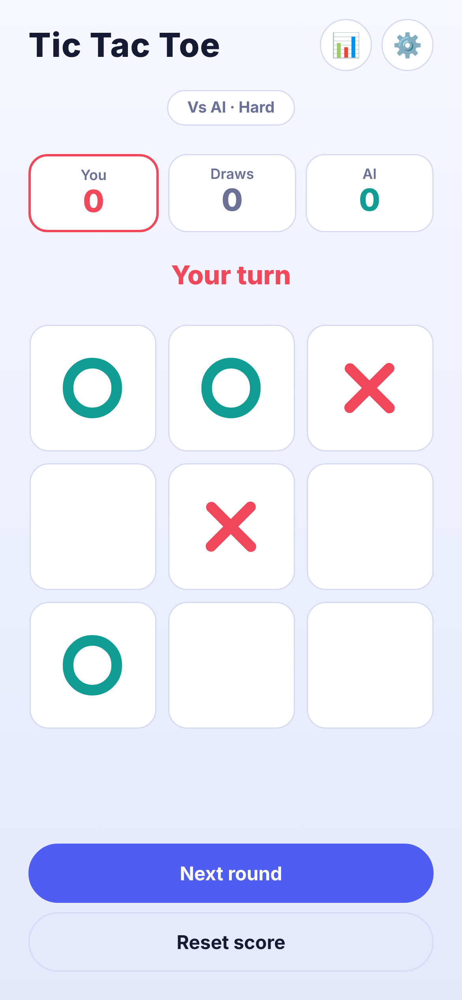
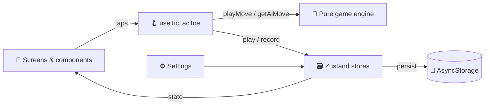

# ❌⭕❌ Tic Tac Toe

**Play against an unbeatable AI or a friend, track your streaks, and enjoy a polished, animated board.** A local-first mobile game built with Expo (React Native), Expo Router and TypeScript, with a pure, tested game engine.

[](https://expo.dev)
[](https://reactnative.dev)
[](https://www.typescriptlang.org)
[](https://zustand.docs.pmnd.rs)
[](https://nodejs.org)
[](LICENSE)

<table>
  <tr>
    <td align="center"><br><sub><b>Game (Dark)</b></sub></td>
    <td align="center"><br><sub><b>Win</b></sub></td>
    <td align="center"><br><sub><b>Statistics</b></sub></td>
    <td align="center"><br><sub><b>Settings</b></sub></td>
    <td align="center"><br><sub><b>Game (Light)</b></sub></td>
  </tr>
</table>

## ✨ Features

- **Two modes**: play against the AI or with a friend on the same device
- **Three AI levels**: Easy (random), Medium (wins and blocks, otherwise random), Hard (unbeatable minimax with alpha-beta pruning)
- **Fair turns**: the first move alternates every round, so the AI starts too
- **Scoreboard**: live X / draws / O score with the active player highlighted
- **Statistics**: played, wins, losses, draws, current streak and best streak, per difficulty
- **Persistence**: the current game, score, statistics and settings survive app restarts
- **Appearance**: system / light / dark theme and Turkish / English (auto-detected from the device)
- **Feel**: Reanimated spring animations on every mark, winning-line highlight and haptic feedback, each switchable in settings
- **Accessibility**: every cell has a spoken label (row, column, value) and the status text is a live region
- **Resilience**: storage failures fall back to memory, so the game never breaks

> There are no accounts and no network calls. Everything stays on your device.

## 🧱 Tech stack

| Layer    | Tools                                                                                                     |
| -------- | --------------------------------------------------------------------------------------------------------- |
| App      | Expo SDK 57, Expo Router (file-based routing, modal screens), React Native 0.86, React 19.2               |
| UI       | `react-native-reanimated` 4, `expo-haptics`, `expo-linear-gradient`, `react-native-safe-area-context`     |
| State    | Zustand 5 with `persist` middleware, `@react-native-async-storage/async-storage`                          |
| Language | TypeScript 6 (strict), path alias `@/*`                                                                   |
| Quality  | Pure-logic test script (`tsx` + `node:assert`), `tsc --noEmit`                                            |

## 🏗️ Architecture



- The **engine** (`src/game`) is plain TypeScript with no React or React Native imports, so it runs and is tested in Node.
- `useTicTacToe` is the only glue: it schedules the AI move, records statistics once per finished game and triggers haptics. Screens just render what it returns.
- A restored game resumes correctly, even when it was saved on the AI's turn. A finished game that is restored is not counted twice.

### How the AI works

| Level  | Strategy                                                                                       |
| ------ | ---------------------------------------------------------------------------------------------- |
| Easy   | Random empty cell                                                                              |
| Medium | Take a winning move, else block the opponent's winning move, else random                       |
| Hard   | Minimax with alpha-beta pruning; picks randomly among equally best moves so games stay varied |

Each level is one entry in a `Record<Difficulty, strategy>`, so adding a level means adding one function.

## 🗂️ Project structure

```
Tic-Tac-Toe/
├── app/                      # Expo Router routes (thin re-exports)
│   ├── _layout.tsx           # providers, splash until stores are hydrated
│   ├── index.tsx             # game
│   ├── settings.tsx          # modal
│   └── stats.tsx             # modal
├── src/
│   ├── components/           # Board, BoardCell, Mark, ScoreBoard, SegmentedControl, Section, Button…
│   ├── game/                 # constants, gameLogic, gameSession, ai, statistics (pure)
│   ├── hooks/                # useTicTacToe, useHaptics, useStoresHydrated
│   ├── i18n/                 # en.ts (schema), tr.ts (must match), useT
│   ├── screens/              # GameScreen, SettingsScreen, StatsScreen
│   ├── storage/              # AsyncStorage wrapper with in-memory fallback
│   ├── store/                # createPersistedStore + settings / stats / game stores
│   ├── theme/                # palettes, ThemeContext, useThemedStyles
│   ├── types/                # shared types
│   └── utils/                # chunk, options, format
├── scripts/
│   └── test-game-logic.ts    # engine tests
└── docs/screenshots/
```

## ♻️ DRY by design

- **`createPersistedStore`**: every store gets the same storage and key scheme
- **`SegmentedControl<T>` + `toOptions`**: mode, difficulty, theme and language use one generic control
- **Generated winning lines**: derived from `BOARD_SIZE`, never hard-coded
- **`settings.update(key, value)`**: one typed setter instead of one per setting
- **`useThemedStyles`**: styles are built from the palette, so components contain no hard-coded colors
- **Typed translations**: `tr.ts` must satisfy the shape of `en.ts`, so a missing string fails at compile time

## 🧪 Tests and type checking

```bash
npm run test:logic   # 10 tests
npm run typecheck
```

The tests cover:

- line generation, rows / columns / both diagonals, draws
- rejected moves (occupied cell, finished game) and turn alternation
- score and outcome helpers, streak and win-rate math
- Medium AI wins and blocks correctly
- Hard AI never loses over hundreds of simulated games, starting as either player, and Hard vs Hard always draws

## 📄 License

MIT, see [LICENSE](LICENSE).
